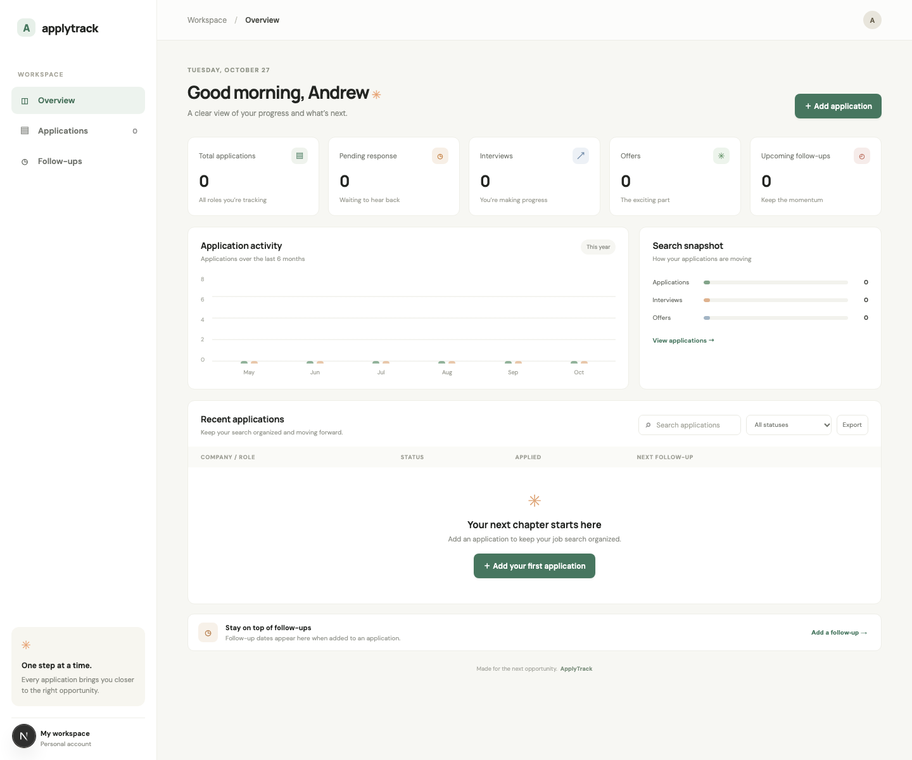
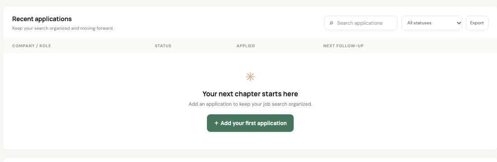

# ApplyTrack

ApplyTrack is a job application tracker built with **Next.js, React, TypeScript, and FastAPI**. The MVP includes an application dashboard, searchable status tracking, follow-up dates, and CSV export.

## Screenshots

### Dashboard



### Applications



## Run with Docker Compose

```sh
docker compose up --build
```

Open [http://localhost:3000](http://localhost:3000). The API docs are at [http://localhost:8000/docs](http://localhost:8000/docs). Application records are stored in a persistent SQLite volume.

## Run locally

Start the API:

```sh
cd backend
python3 -m venv .venv
source .venv/bin/activate
pip install -r requirements.txt
uvicorn app.main:app --reload --port 8000
```

In another terminal, start the frontend:

```sh
npm install
npm run dev
```

The frontend reads `NEXT_PUBLIC_API_URL`, defaulting to `http://localhost:8000`. The API stores data in `backend/app/applytrack.db` by default; set `APPLYTRACK_DB_PATH` to change it. Configure comma-separated browser origins with `CORS_ORIGINS`.

## Included

- Create, update, and delete job applications
- Track company, title, job link, location, salary, contact, notes, status, application date, and follow-up date
- Search and filter by status
- Dashboard totals, activity chart, and application snapshot
- Export application records to CSV
- FastAPI validation, SQLite persistence, health endpoint, and interactive API docs
- Optional Gmail read-only import flow that searches recent sent mail for application emails

## Gmail import setup

Create a Google OAuth web client, enable the Gmail API, and register `http://localhost:8000/integrations/gmail/callback` as an authorized redirect URI. Copy `.env.example` to `.env`, then set `GMAIL_CLIENT_ID` and `GMAIL_CLIENT_SECRET`. In Compose, these values are passed only to the API service. With the local API command, export the same variables before starting Uvicorn.

The Add application form can then connect Gmail and suggest messages from the Sent folder from the last 180 days. ApplyTrack requests Gmail's read-only scope; you review each suggestion before saving an application. OAuth credentials are held in API process memory and are cleared when the API restarts. Use this single-user local MVP only; add authenticated accounts and encrypted, per-user token storage before hosting Gmail connections for multiple users.

## MVP boundaries

This initial version has no user accounts or per-user access control. The API is intended for local development and a single personal workspace; do not expose it publicly with private application data until authentication and authorization are added. Email reminders and optional CC notification recipients are planned but not implemented. The database is SQLite for a simple local MVP; the schema can move to PostgreSQL as the service grows.
